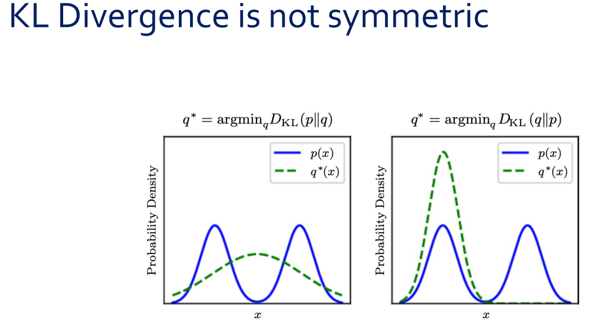

## Overview

To understand deep learning, three mathematical foundations are essential.

- **Probability Theory**: A language for dealing with the uncertainty of data and models
- **Information Theory**: A tool for quantifying differences between probability distributions
- **Numerical Optimization**: A mechanism for learning model parameters

A core challenge called overfitting lies upon these three pillars, and overcoming it is the central task of deep learning research.

---

# Probability Theory

## Random Variable

There are two levels to understanding random variables.

**Simple Definition**: A variable that can take various values randomly. For example, when rolling a die, the result $X$ takes one of $\{1,2,3,4,5,6\}$.

**Strict Definition**: A random variable is a **mapping** that maps elements of a sample space $\Omega$ to a measurable space, usually real numbers $\mathbb{R}$.

$$\text{Real world event} \xrightarrow{\text{Random variable}} \text{Probability (a measurable value)}$$

::: {.callout-tip title="Analogy in Wireless Communication"}
The Channel State Information (CSI) $\mathbf{h}$, which represents the state of the channel, is the random variable. It maps a "real-world event"—the channel environment—to a "measurable value"—a complex vector.
:::

Random variables are classified as **discrete** or **continuous**, and the functions describing each are different.

## Probability Distribution of Discrete Random Variables — PMF

A discrete random variable is described by a **Probability Mass Function (PMF)** $P(x)$. A representative example is the Bernoulli distribution (resulting in $\{0, 1\}$ outcomes such as coin tosses).

PMF must satisfy three axioms.

1. The domain of $P(\cdot)$ must be the set of all possible states of $x$.
2. $\forall x \in \mathbf{x},\; 0 \le P(x) \le 1$
3. $\sum_{x \in \mathbf{x}} P(x) = 1$ (Normalization condition)

## Probability Distribution of Continuous Random Variables — PDF

Continuous random variables are described by a **Probability Density Function (PDF)** $p(x)$. The Gaussian (normal) distribution is typical, $\mu$ represents the mean, and $\sigma^2$ represents the variance.

Three axioms of continuous rv:

1. The domain of $p(\cdot)$ must be the set of all possible states of $x$.
2. $\forall x \in \mathbf{x},\; 0 \le p(x)$ — However, **it does not have to be $p(x) \le 1$!**
3. $\int p(x)\,dx = 1$

::: {.callout-important title="Key Differences Between PMF and PDF"}
In PMF, it is $P(x) \le 1$, but in PDF, $p(x)$ can be greater than 1. For example, in the case of a Gaussian of $\sigma^2 = 0.2$, it is $p(0) \approx 0.89$, and as the variance becomes smaller, the peak exceeds 1. This is because in PDF, the probability is defined not by the value of $p(x)$ itself, but by the **integral $\int_a^b p(x)\,dx$**.
:::

The concept of **measure zero** is also important. In a continuous distribution, the probability of a specific point is $P(\mathbf{x} = x) = 0$. Nevertheless, integrating the entire distribution yields 1. This is the property of "zero almost everywhere, but integrating equals 1" as described in measure theory.

::: {.callout-tip title="Analogy in Wireless Communication"}
The PDF of the AWGN channel noise $n \sim \mathcal{N}(0, \sigma^2)$ is the Gaussian PDF. As the variance $\sigma^2$ decreases (as the SNR increases), the PDF becomes sharper and the peaks become higher, but the integral remains 1.
:::

## Joint Probability Distribution

is the probability that two random variables $\mathbf{x}$ and $\mathbf{y}$ simultaneously take a specific value.

$$P(\mathbf{x} = x, \mathbf{y} = y)$$

It is also simply written as $P(x, y)$. In joint probability, the **order of variables does not matter**. It is $P(A, B, C) = P(B, A, C) = P(C, A, B)$. The intuition regarding "probability of simultaneous occurrence" is accurate.

::: {.callout-tip title="Analogy in Wireless Communication"}
The combined distribution of the transmitted signal $x$ and the received signal $y$ describes the entire channel model.
:::

## Marginal Probability

It is the process of "summing out" one variable from a joint distribution to obtain the distribution of only the remaining variables.

- **Discrete**: $P(\mathbf{x} = x) = \displaystyle\sum_{y} P(\mathbf{x} = x, \mathbf{y} = y)$
- **Consecutive**: $p(x) = \displaystyle\int p(x, y)\,dy$

This process is called **marginalization**.

## Conditional Probability

$$P(\mathbf{y} = y \mid \mathbf{x} = x) = \frac{P(\mathbf{y} = y, \mathbf{x} = x)}{P(\mathbf{x} = x)}$$

Here, $\mathbf{x}$ is the **conditioning variable**, and $\mathbf{y}$ is the **conditioned variable**.

::: {.callout-note title="P(y=y|x=x) is a function of some variable?"}
Strictly speaking, $P(\mathbf{y} = y \mid \mathbf{x} = x)$ is a function of both $x$Z and $y$Z. However, to highlight the essential characteristics of conditional probability, it is often emphasized as a "function of $x$." This is because, while the general $P(\mathbf{y} = y)$ is a function of $y$ alone, the novel aspect is that when a condition is applied, the entire distribution for $y$ changes whenever $x$Z changes. It is obvious that $y$ is a variable, so it is not emphasized separately.

Specifically, it is divided as follows.

- If we fix $y$ and vary $x$ → **likelihood function** $\mathcal{L}(x) = P(\mathbf{y}=y_0 \mid \mathbf{x}=x)$: "With the observation $y_0$ fixed, which $x$ best explains this observation?"
- If we fix $x$ and vary $y$ → **Conditional Distribution** $P(\mathbf{y}=y \mid \mathbf{x}=x_0)$: "What is the shape of the probability distribution of $y$ under the condition $x_0$?"

To use a wireless communication analogy, in the channel model $p(y \mid x) = \frac{1}{\sqrt{2\pi\sigma^2}} \exp\left(-\frac{(y - hx)^2}{2\sigma^2}\right)$, fixing the transmitted signal $x$ results in a Gaussian distribution for the received signal $y$, while fixing the received signal $y$ results in a likelihood representing the probability of observing $y$ when a specific $x$ is transmitted. The interpretation of the same function differs depending on which variable is viewed.
:::

## Conditional Probability Chain Rule {#sec-chain-rule}

### Basic form: 2 variables

From the definition of conditional probability:

$$P(\mathbf{y} = y \mid \mathbf{x} = x) = \frac{P(\mathbf{x} = x, \mathbf{y} = y)}{P(\mathbf{x} = x)}$$

Multiplying both sides by $P(\mathbf{x} = x)$:

$$P(\mathbf{x}, \mathbf{y}) = P(\mathbf{y} \mid \mathbf{x}) \cdot P(\mathbf{x})$$

This is the most basic form of the chain rule. **"joint = conditional × marginal"**.

### Expansion to 3 variables

Let's decompose $P(\mathbf{a}, \mathbf{b}, \mathbf{c})$. Treat $(\mathbf{a})$ and $(\mathbf{b}, \mathbf{c})$ as a single unit and apply the 2-unit rule:

$$P(\mathbf{a}, \mathbf{b}, \mathbf{c}) = P(\mathbf{a} \mid \mathbf{b}, \mathbf{c}) \cdot P(\mathbf{b}, \mathbf{c})$$

Now apply the 2-character rule again to $P(\mathbf{b}, \mathbf{c})$:

$$P(\mathbf{b}, \mathbf{c}) = P(\mathbf{b} \mid \mathbf{c}) \cdot P(\mathbf{c})$$

Combine:

$$\boxed{P(\mathbf{a}, \mathbf{b}, \mathbf{c}) = P(\mathbf{a} \mid \mathbf{b}, \mathbf{c}) \cdot P(\mathbf{b} \mid \mathbf{c}) \cdot P(\mathbf{c})}$$

### $n$ Generalization of variables

If you repeat the same "peeling":

$$P(\mathbf{x}^{(1)}, \ldots, \mathbf{x}^{(n)}) = P(\mathbf{x}^{(1)}) \prod_{i=2}^{n} P(\mathbf{x}^{(i)} \mid \mathbf{x}^{(1)}, \ldots, \mathbf{x}^{(i-1)})$$

This is called a **chain rule** or **product rule**.

::: {.callout-note title="Derivation process of the generalized formula"}
If you first remove ZZZPH0006279ZZZ  $\mathbf{x}^{(1)}$ from $P(\mathbf{x}^{(1)}, \ldots, \mathbf{x}^{(n)})$:

$$= P(\mathbf{x}^{(1)} \mid \mathbf{x}^{(2)}, \ldots, \mathbf{x}^{(n)}) \cdot P(\mathbf{x}^{(2)}, \ldots, \mathbf{x}^{(n)})$$

If you remove $\mathbf{x}^{(2)}$ from $P(\mathbf{x}^{(2)}, \ldots, \mathbf{x}^{(n)})$:

$$= P(\mathbf{x}^{(1)} \mid \mathbf{x}^{(2)}, \ldots, \mathbf{x}^{(n)}) \cdot P(\mathbf{x}^{(2)} \mid \mathbf{x}^{(3)}, \ldots, \mathbf{x}^{(n)}) \cdot P(\mathbf{x}^{(3)}, \ldots, \mathbf{x}^{(n)})$$

Repeating this until only $P(\mathbf{x}^{(n)})$ remains yields the final formula. Regardless of the direction from which the decomposition begins (the method above leaves $\mathbf{x}^{(n)}$ as the last marginal, while the formula form places $\mathbf{x}^{(1)}$ as the first marginal), the result is the same.
:::

::: {.callout-note title="Intuitive interpretation"}
You can think of "Probability of $\mathbf{a}$, $\mathbf{b}$, $\mathbf{c}$ occurring simultaneously" as **sequential decision**:

> First, $\mathbf{c}$ occurs → then, with $\mathbf{c}$ given, $\mathbf{b}$ occurs → finally, with all $\mathbf{b}, \mathbf{c}$ given, $\mathbf{a}$ occurs.

The order of joint probabilities does not matter, but the form of the equation changes depending on the **order of condition application** when decomposing using the chain rule. This choice becomes an important design decision in modeling.
:::

::: {.callout-tip title="Deep Learning Connection: Autoregressive Model"}
Autoregressive models like GPT utilize this very chain rule when generating sequences.

$$P(w_1, w_2, \ldots, w_n) = P(w_1) P(w_2|w_1) P(w_3|w_1, w_2) \cdots$$

Sequentially generating tokens is a direct application of the chain rule.
:::

## Independence and Conditional Independence (Independence & Conditional Independence)

### Independence

If $\mathbf{x}$ and $\mathbf{y}$ are independent, the joint distribution is decomposed into the product of the marginal distributions:

$$p(\mathbf{x} = x, \mathbf{y} = y) = p(\mathbf{x} = x)p(\mathbf{y} = y)$$

### Conditional Independence

Given $\mathbf{z}$, if $\mathbf{x}$ and $\mathbf{y}$ are conditionally independent:

$$p(\mathbf{x} = x, \mathbf{y} = y \mid \mathbf{z} = z) = p(\mathbf{x} = x \mid \mathbf{z} = z)p(\mathbf{y} = y \mid \mathbf{z} = z)$$

::: {.callout-warning title="Independence and conditional independence do not imply each other"}
Two independent variables can become conditionally dependent if a common outcome is observed (explaining away), and conversely, two dependent variables can become conditionally independent if a certain variable is given.
:::

### Explaining Away Phenomenon {#sec-explaining-away}

Explaining away is a classic example of **conditional dependency**. The key point is: **Two independent variables become conditionally dependent if a common outcome is observed**.

Let's take an example from wireless communication. Suppose the received signal suddenly weakens ($Y = \text{weak}$). There are two possible causes:

- (A) Transmitter failure
- (B) Shadowing by buildings

Since A and B are physically independent events, it is $P(A, B) = P(A)P(B)$.

However, the situation changes after **observing** $Y = \text{weak}$. If someone confirms that "it was due to building shadowing" ($B = \text{true}$), one infers, "Then the probability of a transmitter failure is low." In other words:

$$P(A \mid Y, B = \text{true}) < P(A \mid Y)$$

If one cause **explains away** the result, the probability of the other cause decreases. In a formula:

$$P(A, B \mid Y) \neq P(A \mid Y) P(B \mid Y)$$

$A$ and $B$ were originally independent, but became **conditionally dependent** when the common result $Y$ was observed.

There is also an example in the opposite direction. The throughput of two users at the same base station is dependent (sharing the same base station load), but they can be conditionally independent given the base station load $Z$.

## Expectation

is an operator representing the "most likely occurring value" of a random variable.

- **Discrete**: $\mathbb{E}_{\mathbf{x} \sim P}[f(x)] = \displaystyle\sum_x P(x)f(x)$
- **Consecutive**: $\mathbb{E}_{\mathbf{x} \sim p}[f(x)] = \displaystyle\int p(x)f(x)\,dx$

As a key property, **expectation is a linear operator**:

$$\mathbb{E}_{\mathbf{x}}[\alpha f(x) + \beta g(x)] = \alpha \mathbb{E}_{\mathbf{x}}[f(x)] + \beta \mathbb{E}_{\mathbf{x}}[g(x)]$$

## Dirac Delta Function {#sec-dirac-delta}

It is a "function" (strictly speaking, a distribution) that is 0 everywhere except the origin, but becomes 1 when integrated.

### The reason the integral is 1

Strictly speaking, the Dirac delta is not an ordinary function. A function that is "zero everywhere and integrates to 1" does not exist in the classical sense. The Dirac delta is a **generalized function**, defined as an operator acting on other functions:

$$\int_{-\infty}^{\infty} \delta(x) f(x)\,dx = f(0)$$

This is the **definition** of Dirac delta. If you substitute $f(x) = 1$, it becomes $\int \delta(x)\,dx = 1$. The fact that the integral is 1 is not a proof, but **derived from the definition**.

::: {.callout-note title="Intuitive Understanding: Dirac delta as an extreme process"}
Let's imagine a Gaussian where the variance gradually decreases:

$$\delta(x) = \lim_{\sigma \to 0} \frac{1}{\sqrt{2\pi\sigma^2}} \exp\left(-\frac{x^2}{2\sigma^2}\right)$$

No matter how small $\sigma$ becomes, the integral of the Gaussian is always 1. Although the peaks become infinitely high and the width becomes infinitely narrow, the **area (integral) is always conserved**. This limit is the Dirac delta.
:::

### Empirical Distribution

Dirac delta is used when constructing the empirical distribution of continuous random variables:

$$\hat{p}(\mathbf{x}) = \frac{1}{m} \sum_{i=1}^{m} \delta(\mathbf{x} - \mathbf{x}^{(i)})$$

This is a method of representing continuous rv discretely by assigning equal weights $1/m$ to $m$ observations. This concept of empirical distribution serves as the starting point for Maximum Likelihood Estimation (MLE).

## Mixture of Distributions {#sec-mixture}

$$P(\mathbf{x}) = \sum_i P(\mathbf{c} = i) P(\mathbf{x} \mid \mathbf{c} = i)$$

Here, $P(\mathbf{c})$ represents the multinoulli distribution (which component to select), and $\mathbf{c}$ is the **latent variable**. The most representative mixture distribution is the **Gaussian Mixture Model (GMM)**, where each component $P(\mathbf{x} \mid \mathbf{c} = i)$ is Gaussian.

GMM is called the **universal approximator of densities**. By using a sufficient number of Gaussian components, any continuous density can be approximated with desired precision.

### Why is $c$ called a "latent variable"?

The only one actually observed is $\mathbf{x}$. $\mathbf{c}$ is a variable indicating "which component this data point came from," but it **cannot be directly observed**. "Latent" is Latin for "hidden" and refers to a variable that is unobservable but necessary to explain the data generation process.

::: {.callout-tip title="Analogy in Wireless Communication"}
Let's assume we have Received Signal Strength Indicator (RSSI) data collected from various base stations in a city. Looking at the overall distribution, it is a complex shape with multiple peaks. In fact, each peak originates from a measurement point close to a different base station, but the data does not record "which base station the data came from." This "which base station" is precisely the latent variable $\mathbf{c}$.

- $P(\mathbf{c} = i)$: Probability of measuring near the $i$th base station
- $P(\mathbf{x} \mid \mathbf{c} = i)$: RSSI distribution near the $i$-th base station
:::

### Importance in Deep Learning

The idea of a mixture of distributions is the foundation of core generative models in deep learning.

**VAE(Variational Autoencoder)**: $\mathbf{c}$ is extended to a continuous latent vector $\mathbf{z}$ instead of a discrete one.

$$P(\mathbf{x}) = \int P(\mathbf{x} \mid \mathbf{z}) P(\mathbf{z})\,d\mathbf{z}$$

It is a continuous mixture of infinitely many components.

**GAN**: Passing random noise $\mathbf{z}$ through a generator to produce $\mathbf{x} = G(\mathbf{z})$ is a generalization of mixture, which generates a complex data distribution from a latent variable $\mathbf{z}$.

**Softmax Output**: The classification model outputting $P(\mathbf{c} = i \mid \mathbf{x})$ is solving the inverse problem of the mixture using Bayes' rule. "From which component is it most likely that this data $\mathbf{x}$ to have come?"

## Bayes' Rule

$$P(\mathbf{x} \mid \mathbf{y}) = \frac{P(\mathbf{x})P(\mathbf{y} \mid \mathbf{x})}{P(\mathbf{y})}$$

is a formula that swaps the roles of $\mathbf{x}$ and $\mathbf{y}$ in conditional probability. The names of each term are as follows.

| Item | Name | Meaning |
|---|---|---|
| $P(\mathbf{x})$ | **Prior (Prior Probability)** | Belief in $\mathbf{x}$ prior to observation |
| $P(\mathbf{y} \mid \mathbf{x})$ | **Likelihood** | Probability of observing $\mathbf{y}$ under $\mathbf{x}$ |
| $P(\mathbf{x} \mid \mathbf{y})$ | **Posterior (Posterior Probability)** | Updated belief in $\mathbf{x}$ after observation |
| $P(\mathbf{y})$ | **Evidence** | Total probability of observation $\mathbf{y}$ (normalization constant) |

: Names and Meanings of Each Clause in Bayes' Rule {.striped}

::: {.callout-tip title="Analogy in Wireless Communication"}
The MAP(Maximum a Posteriori) detector uses exactly this Bayes' rule. After observing the received signal $\mathbf{y}$, it maximizes the posterior probability of the transmitted signal $\mathbf{x}$:

$$\hat{\mathbf{x}} = \arg\max_{\mathbf{x}} P(\mathbf{x} \mid \mathbf{y})$$
:::

---

# Information Theory

## Origins of Information Theory

Information theory was born in 1948 when Shannon studied the problem of **transmitting discrete alphabet messages over a noisy channel**.

## Self-Information {#sec-self-info}

$$I(x) = -\log P(x)$$

The unit is **nat** (when using natural logarithm).

### Intuitive Understanding: "Degree of Surprise (Surprise)"

If you think of your amount of self-information as the **degree of surprise**, your intuition becomes clearer.

The probability that the sun will rise tomorrow is almost 1. What is your reaction if someone says, "They say the sun will rise tomorrow!"? "So what?" — Not surprising at all, and there is no new information. Since $P \approx 1$, it is $I = -\log(1) = 0$.

On the other hand, if someone says, "They say it's going to snow 3 meters in Seoul tomorrow!", you are extremely surprised, and your behavior changes drastically after hearing this information (canceling appointments, preparing, etc.). Since $P \approx 0$, it is $I = -\log(\epsilon) \to \infty$.

::: {.callout-important title="Key Insights into Information Theory"}
**Value of Information = Amount of change in belief before and after hearing it.** There is no information when hearing about a certain event because belief does not change, and there is a large amount of information when hearing about the outcome of an uncertain event because belief changes significantly.
:::

### Why $\log$ of all things?

**Reason 1: Additive nature of independent events.** The information of independent events must be additive. If they are independent, it is $P(x_1, x_2) = P(x_1)P(x_2)$, and the function that converts this product into a sum is $\log$:

$$-\log(P(x_1)P(x_2)) = -\log P(x_1) - \log P(x_2) = I(x_1) + I(x_2)$$

**Reason 2: Origin in communication.** To transmit one of $n$ messages of equal probability, $\log_2 n$ bits are required. Since the probability of each message is $1/n$, it is $-\log_2(1/n) = \log_2 n$.

## Shannon Entropy (Shannon Entropy) {#sec-entropy}

The expected value of self-information is **Shannon entropy**:

$$H(\mathbf{x}) = \mathbb{E}_{\mathbf{x} \sim P}[I(x)] = -\mathbb{E}_{\mathbf{x} \sim P}[\log P(x)]$$

Entropy measures the amount of **uncertainty** contained in a probability distribution.

If $\mathbf{x}$ is a continuous random variable, it is called **differential entropy**. It should be noted that, unlike discrete entropy, continuous entropy can be negative.

### The reason why entropy is maximum in the Bernoulli variable when $p = 0.5$

::: {.callout-warning title="Caution against confusion between self-information and entropy"}
Self-information $I(x) = -\log P(x)$ is the information amount of a specific event **one**, and as $P(x)$ increases, it **monotonically decreases**. This is correct.

However, entropy is the **expected value** of self-information:

$$H = -\sum_x P(x) \log P(x)$$

This is the **weighted average** of $I(x)$ and $P(x)$, so it is not monotonically decreasing.
:::

Since Bernoulli($p$) variable $\mathbf{x} \in \{0, 1\}$:

$$H = -p \log p - (1-p) \log(1-p)$$

The key point is that there are **two** terms for . If you increase $p$, the size of $\log p$ in the first term decreases, but the weight $p$ increases; simultaneously, in the second term, $(1-p)$ decreases, but the size of $\log(1-p)$ increases. It is a structure where these two effects compete.

Specifically calculated:

| $p$ | $H$ |
|-----|-----|
| 0.1 | $\approx 0.33$ |
| 0.5 | $\approx 0.69$ (max) |
| 0.9 | $\approx 0.33$ |

: Entropy values according to the probability of Bernoulli variables {.striped}

The reason it reaches a maximum at $p = 0.5$ is that at this point, **both events are in a "moderately surprising" state**. If it is $p = 0.99$, $x = 1$ is almost certain (no surprise), and $x = 0$ is very surprising but rarely occurs, so the **average surprise** is small. Average surprise is maximized when both events are equally uncertain.

## KL Divergence (Kullback-Leibler divergence) {#sec-kl-divergence}

$$D_{KL}(p \| q) = \sum_x p(x)(\log p(x) - \log q(x))$$

It is a **"kind of distance"** between two probability distributions $p$ and $q$, but it is not a true distance metric.

### The 4 Axioms of Metrics and KL Divergence

For the distance function (metric) ZZZPH0006379ZZZ  to be $d(x, y)$, four axioms must be satisfied:

| Axiom | Formula | Whether KL divergence is satisfied |
|------|------|------|
| Nasal | $d(x, y) \ge 0$ | **Satisfied** |
| Identity of the unidentifiable | $d(x, y) = 0 \leftrightarrow x = y$ | **Satisfaction** |
| Symmetry | $d(x, y) = d(y, x)$ | **Dissatisfaction** |
| Triangle Inequality | $d(x, z) \le d(x, y) + d(y, z)$ | **Dissatisfied** |

: KL Divergence metric axiom satisfaction {.striped}

::: {.callout-important title="KL Divergence does not satisfy the triangle inequality either."}
Not only symmetry but also the triangle inequality is broken. As a specific counterexample, consider the three Bernoulli distributions $p = (0.1, 0.9)$, $q = (0.5, 0.5)$, and $r = (0.9, 0.1)$:

$$D_{KL}(p \| r) \approx 1.76 > D_{KL}(p \| q) + D_{KL}(q \| r) \approx 0.51 + 0.51 = 1.02$$

Therefore, since KL divergence satisfies only 2 of the 4 metric axioms, it is called "divergence" and not "distance". On the other hand, the square root of the Jensen-Shannon divergence $\sqrt{D_{JS}}$ becomes a true metric.
:::

KL divergence has **directionality**, so it is read as "from $p$ to $q$". There are also symmetric variations:

- **Symmetric KL divergence**: $D_{KL}(p, q) + D_{KL}(q, p)$
- **Jensen-Shannon divergence**: $D_{JS}(p, q) = \frac{D_{KL}(p \| m) + D_{KL}(q \| m)}{2}$, where $m = \frac{p+q}{2}$

JS divergence appears in the original objective function of GAN (Generative Adversarial Network).

### Asymmetry of KL Divergence — Intuitive Understanding {#sec-kl-asymmetry}

The key to understanding asymmetry is **which distribution acts as the "weight" in the KL divergence formula**.

$$D_{KL}(p \| q) = \sum_x p(x) \log \frac{p(x)}{q(x)}$$

Here, since $p(x)$ is the **weight** of the sum, the **difference where $p(x)$ is large is dominant**.

::: {layout-align="center"}

:::

#### Forward KL: $q^* = \arg\min_q D_{KL}(p \| q)$

Let $p$ be a bimodal (two peaks), and let $q$ be constrained to a single Gaussian.

Since the weight of is $p(x)$, if $q(x) \approx 0$ occurs where $p(x) > 0$, it becomes $\log \frac{p(x)}{q(x)} \to +\infty$, causing KL to explode. Therefore, $q$ must **cover all places where $p$ is positive**. To cover both peaks, $q$ must spread widely.

Result: **Wide and flat $q^*$** → **"mean-seeking"** or **"zero-avoiding"** behavior.

#### Reverse KL: $q^* = \arg\min_q D_{KL}(q \| p)$

From $D_{KL}(q \| p) = \sum_x q(x) \log \frac{q(x)}{p(x)}$, the weight is now $q(x)$. At $q(x) > 0$, if it becomes $p(x) \approx 0$, KL explodes.

Therefore, $q$ should not have mass placed where $p$Z is 0. Since $p \approx 0$ is in the valley between the two peaks, the safest strategy is to **concentrate on only one peak**.

Result: **Narrow and pointed $q^*$** → **"mode-seeking"** or **"zero-forcing"** behavior.

::: {.callout-tip title="Understanding Forward KL vs Reverse KL via Wireless Communication Analogy"}
Let's consider a situation where there are signals in two frequency bands.

- Approximation as **Forward KL**($p \| q$): "The band containing the signal must never be missed" → Design a **broadband filter** that covers both bands. **The cost of missing is high.**
- Approximation by **Reverse KL**($q \| p$): "Filters should not be placed in bands containing only noise" → Design a **narrow-band filter** that focuses on only one band. **The cost of false alarms is high.**
:::

::: {.callout-note title="Meaning in Deep Learning"}
- Training a model with **MLE (Maximum Likelihood Estimation)** is equivalent to minimizing the forward KL $D_{KL}(\hat{p}_{\text{data}} \| p_{\text{model}})$ → the model attempts to cover all modes of the data.
- In Variational Inference, optimizing the ELBO minimizes the reverse KL $D_{KL}(q \| p)$ → the approximate distribution is concentrated in one mode of the posterior.
:::

---

# Numerical Optimization

## Basic Concepts of Gradient-based Optimization

**Optimization** is the process of minimizing or maximizing a function.

- The function to be minimized or maximized is called the **objective function** or **criterion**.
- When minimizing, it is called the **cost function**, **loss function**, and **error function**.
- The optimal solution is denoted as $\hat{x} = x^* = \arg\min_x f(x)$. $\hat{\ }$(hat) represents the estimated value, and $*$(star) represents the optimal value.

## Gradient Descent {#sec-gradient-descent}

The key principle is that **moving in the opposite direction of the gradient reduces the function value**:

$$x_{t+1} = x_t - \epsilon \nabla_x f(x_t)$$

Here, $\epsilon$ is the **learning rate**.

In the example of $f(x) = \frac{1}{2}x^2$:

- Moving from $x < 0$ to $f'(x) < 0$ → to the right decreases $f$
- If you move from $x > 0$ to $f'(x) > 0$ → left, $f$ decreases
- Gradient descent stops at the point $f'(x) = 0$ (here, $x = 0$) → **global minimum**

## Convex Optimization

If the function is **convex**, then **local minimum = global minimum**, so gradient descent can definitely find the global optimal solution.

::: {.callout-warning title="The loss landscape of deep learning is non-convex."}
In deep learning, gradient descent cannot guarantee a global minimum and can get stuck in local minimums or saddle points. Nevertheless, the reason SGD actually works well is due to its unique structure in high-dimensional spaces (most critical points are saddle points), implicit regularization, etc.
:::

## Constrained Optimization {#sec-constrained-opt}

General form of a constrained optimization problem:

$$\min f(\mathbf{x}) \quad \text{subject to} \quad g_i(\mathbf{x}) = c_i \;\text{(등식)},\quad h_j(\mathbf{x}) \ge d_j \;\text{(부등식)}$$

It is much more difficult than unconstrained optimization.

## Lagrangian — Converting equation constraints into unconstrained problems {#sec-lagrangian}

### Basic Idea

Original constraint problem:

$$\text{maximize } f(\mathbf{x}) \quad \text{subject to } g(\mathbf{x}) = 0$$

Transform this into a new unconstrained objective function (**Lagrangian**):

$$\mathcal{L}(\mathbf{x}, \lambda) = f(\mathbf{x}) - \lambda g(\mathbf{x})$$

Here, $\lambda$ is the **Lagrange multiplier**.

::: {.callout-note title="Reason for expanding to 2D"}
In optimization problems, when $\mathbf{x}$ is a vector, there are cases where the components are explicitly expanded into $\mathbf{x} = (x, y)$ for visualization. In this case, it is denoted as $\mathcal{L}(x, y, \lambda) = f(x, y) - \lambda g(x, y)$, but this does not mean that a new variable $y$ has been added; rather, it is **explicitly expanding the components of the vector $\mathbf{x}$**. This is because it must be written in 2D to draw contour lines.
:::

### Why can it only be used for equation constraints?

The equation constraint $g(\mathbf{x}) = 0$ defines a **surface** in space. The task is to move along this surface and find the point where $f$ no longer increases.

Geometric intuition: **At the optimal point, the contour line of the objective function is tangent to the constraint curve**, i.e., $\nabla f = \lambda \nabla g$.

This means that "the change in $f$ is zero in all directions that can move on the surface." That is, $\nabla f$ must be **perpendicular** to the constraint plane, and since the vector perpendicular to the constraint plane is $\nabla g$, $\nabla f = \lambda \nabla g$ holds.

The inequality constraint $h(\mathbf{x}) \ge 0$ defines a **region** rather than a surface. The optimal point may be inside the region (inactive constraint) or on the boundary (active constraint). To handle these two cases integrally, the **KKT condition** is required.

### Why the Lagrangian guarantees optimality

The stationary point condition of Lagrangian $\mathcal{L}(\mathbf{x}, \lambda) = f(\mathbf{x}) - \lambda g(\mathbf{x})$ is:

$$\frac{\partial \mathcal{L}}{\partial \mathbf{x}} = 0 \quad \Rightarrow \quad \nabla f = \lambda \nabla g$$
$$\frac{\partial \mathcal{L}}{\partial \lambda} = 0 \quad \Rightarrow \quad g(\mathbf{x}) = 0$$

The second condition **automatically satisfies the constraint**. If you add $\lambda$ as a variable and find the stationary point of $\mathcal{L}$, the constraint is automatically embedded.

::: {.callout-note title="Physical meaning of $\\lambda$: Shadow Price"}
$\lambda$ is the **shadow price**. If the constraint is slightly relaxed from $g(\mathbf{x}) = 0$ to $g(\mathbf{x}) = \epsilon$, the value of the optimal objective function changes by approximately $\lambda \epsilon$.

In wireless communication, the Lagrange multiplier of power constraints represents "a capacity increase of 1 unit of additional power," and the water level $\frac{1}{\lambda}$ in waterfilling is derived from this Lagrange multiplier.
:::

## KKT conditions — including inequality constraints {#sec-kkt}

Including inequality constraints, the generalized Lagrangian is:

$$L(\mathbf{x}, \boldsymbol{\mu}, \boldsymbol{\lambda}) = f(\mathbf{x}) + \boldsymbol{\mu}^\top \mathbf{g}(\mathbf{x}) + \boldsymbol{\lambda}^\top \mathbf{h}(\mathbf{x})$$

$\boldsymbol{\mu}$ and $\boldsymbol{\lambda}$ are called **KKT multipliers** (named after Karush, Kuhn, and Tucker).

In KKT, the condition $\mu_i g_i(\mathbf{x}) = 0$ (**complementary slackness**) is added, and it automatically handles "$\mu > 0$ if the constraint is active, and $\mu = 0$ if it is inactive".

## Example: Linear Least Squares {#sec-linear-least-squares}

### Non-constrained problem

Objective function:

$$f(\mathbf{x}) = \frac{1}{2}\|\mathbf{A}\mathbf{x} - \mathbf{b}\|_2^2$$

Gradient:

$$\nabla_{\mathbf{x}} f(\mathbf{x}) = \mathbf{A}^\top(\mathbf{A}\mathbf{x} - \mathbf{b}) = \mathbf{A}^\top\mathbf{A}\mathbf{x} - \mathbf{A}^\top\mathbf{b}$$

Gradient descent algorithm:

1. Set step size $\epsilon$ and tolerance $\delta$
2. Repeat while $\|\mathbf{A}^\top\mathbf{A}\mathbf{x} - \mathbf{A}^\top\mathbf{b}\|_2 > \delta$:
   - $\mathbf{x} \leftarrow \mathbf{x} - \epsilon(\mathbf{A}^\top\mathbf{A}\mathbf{x} - \mathbf{A}^\top\mathbf{b})$

### Added constraint: $\mathbf{x}^\top\mathbf{x} \le 1$

Lagrangian:

$$L(\mathbf{x}, \lambda) = \frac{1}{2}\|\mathbf{A}\mathbf{x} - \mathbf{b}\|_2^2 + \lambda(\mathbf{x}^\top\mathbf{x} - 1)$$

If we differentiate with $\mathbf{x}$ and set it to 0:

$$\mathbf{A}^\top\mathbf{A}\mathbf{x} - \mathbf{A}^\top\mathbf{b} + 2\lambda\mathbf{x} = 0$$

$$\boxed{\mathbf{x} = (\mathbf{A}^\top\mathbf{A} + 2\lambda\mathbf{I})^{-1}\mathbf{A}^\top\mathbf{b}}$$

::: {.callout-tip title="Connection with Wireless Communication: MMSE Estimator and Ridge Regression"}
The form of this result has exactly the same structure as a wireless communication MMSE estimator:

$$\hat{\mathbf{x}}_{\text{MMSE}} = (\mathbf{H}^H\mathbf{H} + \sigma^2\mathbf{I})^{-1}\mathbf{H}^H\mathbf{y}$$

$\lambda$ acts as regularization and corresponds to $\sigma^2$ (noise power). In other words, **constraint optimization ↔ regularization is equivalent through the Lagrangian**. Adjusting the strength of the constraint to $\lambda$ is equivalent to adjusting the strength of regularization.
:::

---

# Overfitting and Lipschitz Continuity

## Definition of Overfitting

data is generated from the distribution $D(X, Y)$, and when finding the hypothesis $h$ within the hypothesis space $\mathcal{H}$, the hypothesis $h$ is said to be **overfitted** if there exists another hypothesis $h' \in \mathcal{H}$:

$$\text{error}_{\text{train}}(h) < \text{error}_{\text{train}}(h')$$

**but**

$$\text{error}_{\text{true}}(h) > \text{error}_{\text{true}}(h')$$

It refers to the state where . In other words, it is a state where the training error is lower but the actual error is higher.

## Neural Network and Lipschitz Continuity

Neural networks are susceptible to overfitting. This is because small changes in input can cause dramatic changes in output.

**Lipschitz continuity** is a tool for controlling this:

$$\forall \mathbf{x}, \forall \mathbf{y},\; |f(\mathbf{x}) - f(\mathbf{y})| \le \mathcal{L}\|\mathbf{x} - \mathbf{y}\|_2$$

The smaller the Lipschitz constant $\mathcal{L}$, the smoother the function's changes relative to input changes, and therefore, the less overfitting occurs. In practice, regularization techniques such as spectral normalization and gradient penalty stabilize the model by limiting the Lipschitz constant. WGAN (Wasserstein GAN) is a representative model that utilizes the Lipschitz constraint.

## Why use Neural Networks despite this?

The purpose of ML is generalization, so why use neural networks that are susceptible to overfitting? This is a core question, and the answer is found through the double descent phenomenon, along with various techniques such as regularization, dropout, batch normalization, early stopping, and data augmentation.

---

# Reference materials

## Correspondence to Goodfellow et al. Deep Learning textbook

| Topic | Corresponding Chapter |
|------|-------------|
| Probability Theory, Information Theory | Chapter 3: Probability and Information Theory |
| Numerical Optimization | Chapter 4: Numerical Computation |
| Gradient-Based Optimization | Section 4.3 |
| Constrained Optimization | Section 4.4 |

: Goodfellow textbook correspondence {.striped}

## d2l.ai response

| Topic | Corresponding Section |
|------|-------------|
| Basic Probability Theory | [Section 2.6: Probability](https://d2l.ai/chapter_preliminaries/probability.html) |
| Gradient Descent Details | [Section 12.3: Gradient Descent](https://d2l.ai/chapter_optimization/gd.html) |
| Non-convex optimization | [Section 12.6: Optimization and Deep Learning](https://d2l.ai/chapter_optimization/optimization-intro.html) |

: d2l.ai correspondence {.striped}

## Correspondence to Mathematics for Machine Learning (GW Thomas)

| Topic | Corresponding Chapter |
|------|-------------|
| Fundamentals of Probability Theory (Measure-Theoretic Perspective) | [Chapter 3: Probability](https://gwthomas.github.io/docs/math4ml.pdf) |
| Gradient descent convergence theory, Lagrangian/KKT | [Chapter 4: Optimization](https://gwthomas.github.io/docs/math4ml.pdf) |

: Mathematics for ML counterpart {.striped}
